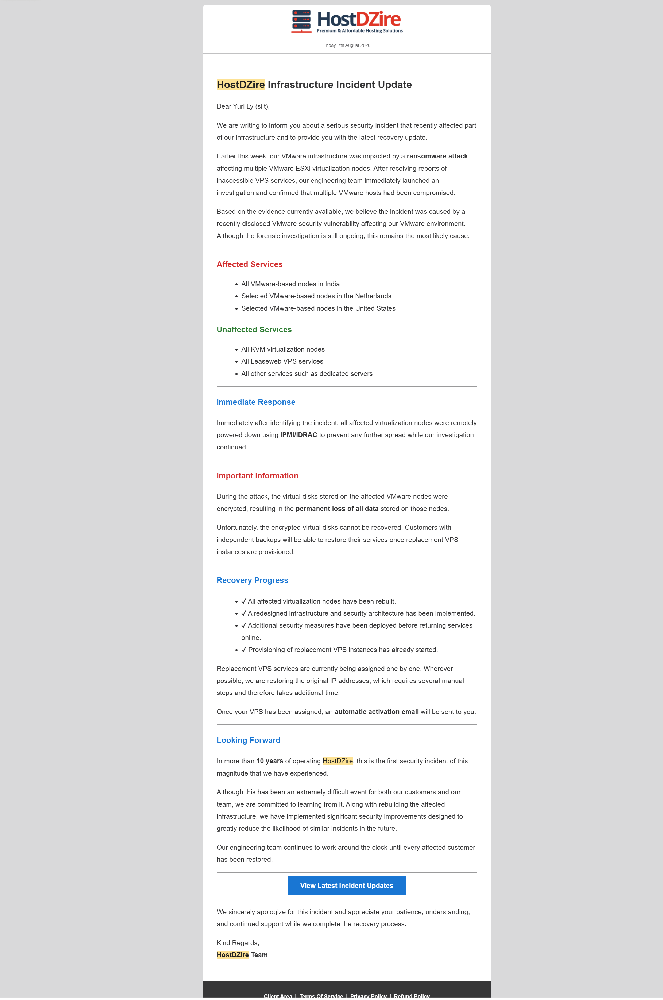
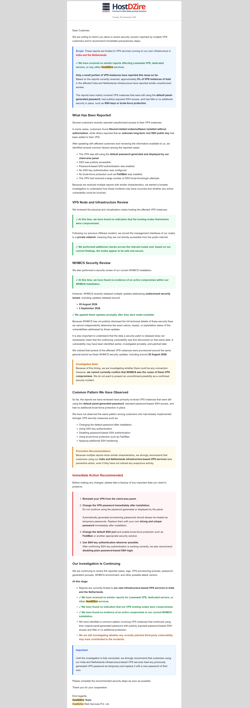
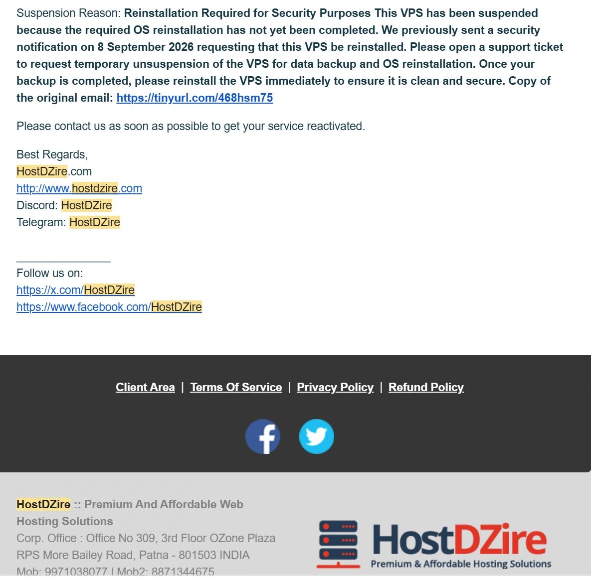
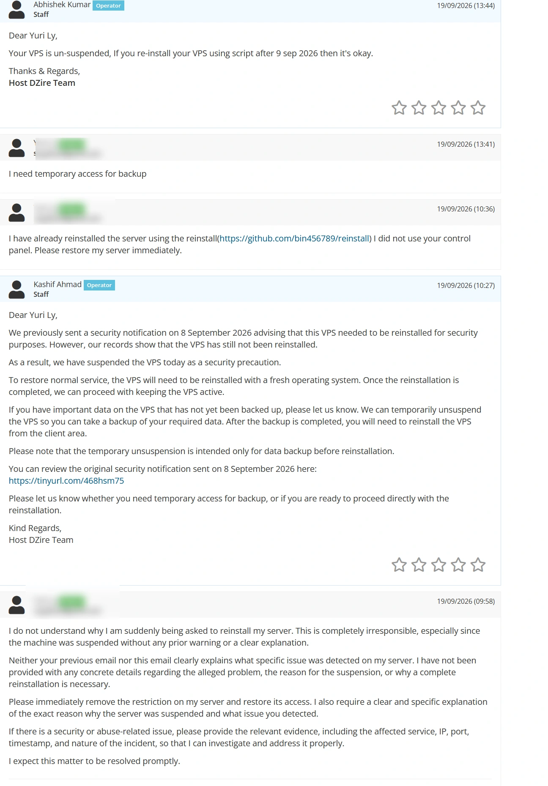
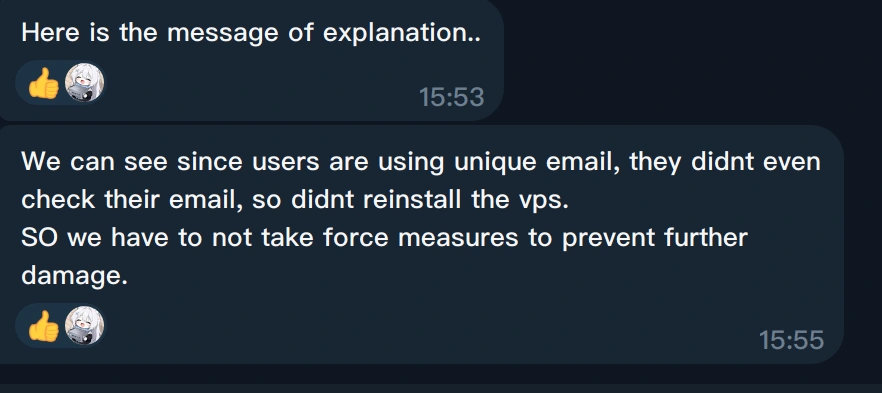
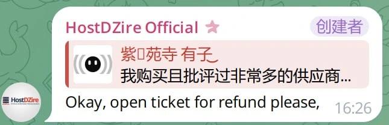
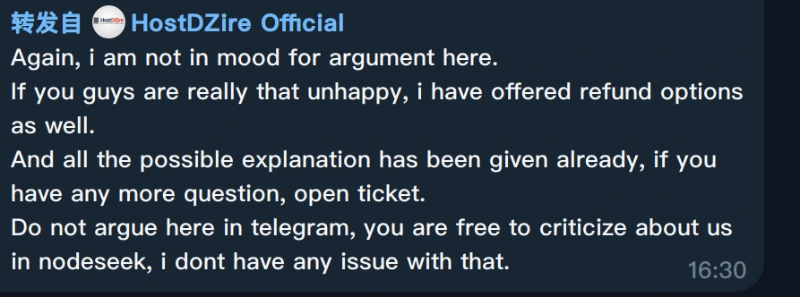
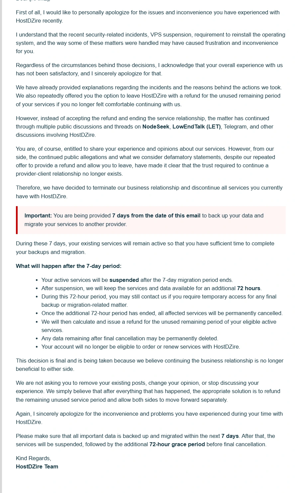

相关讨论：

- [NodeSeek #938769：官方回复、踢群和后续](https://www.nodeseek.com/post-938769-1)
- [NodeSeek #937638：两次安全事件和无预警停机](https://www.nodeseek.com/post-937638-1)
- [LowEndTalk：无通知停机，要求道歉](https://lowendtalk.com/discussion/221287/hostdzire-shut-me-down-with-no-notice-i-want-an-apology/p1)

## 时间线

### 2026 年 8 月初：VMware 遭勒索，数据被宣告永久丢失

约 2026 年 8 月 5 日，HostDZire 发出题为 serious security incident 的邮件。他们的 VMware ESXi 基础设施遭受勒索攻击。



邮件里的要点：

- 印度机房的全部 VMware 节点中招。荷兰和美国的部分 VMware 节点也中招。
- 攻击者加密了宿主机上的虚拟磁盘。官方称没有可用的冷备份或异地灾备，数据永久丢失，无法恢复。
- 处置方式是通过 IPMI/iDRAC 给受影响母鸡断电，再重建系统。
- 对用户的补偿是道歉，并延长一点使用时间。

LowEndTalk 和 NodeSeek 上当时有大量用户报告数据丢失。

### 2026 年 9 月 8 日：自营 VPS 再次被入侵

距离上次勒索大约一个月，NodeSeek、Telegram 和 LowEndTalk 上再次出现同一类报告：HostDZire 印度及荷兰自营节点上的 VPS 被入侵。

当时公开描述的共同特征：

1. 机器上被安装与 Xboard 相关的代理服务端。
2. `/root/.ssh/authorized_keys` 被写入未知的 root SSH 公钥。image.png

相关帖：[NodeSeek #918583](https://www.nodeseek.com/post-918583-1)。

同一天，官方发出邮件通知。


这封邮件的口径是：

1. 称母鸡物理节点没有发现被入侵，WHMCS 面板也没有发现活动入侵迹象。同时提到 WHMCS 在 8 月 25 日和 9 月 3 日发布过未公开的安全补丁。
2. 把受害用户的共同点归到用户侧：使用控制台生成的默认密码、SSH 对公网开放并允许密码登录、没有使用 SSH 密钥、没有安装 Fail2Ban。
3. 后半部分的用词是建议，不是最后通牒。原文包括 Preventive Recommendation 和 Immediate Action Recommended。建议内容包括在面板重装、改强密码、改 SSH 端口、安装 Fail2Ban、改用密钥登录。

2026 年 9 月 8 日这封邮件通篇是建议。它没有给出截止日期，也没有写「未在面板重装就会强制关机或停机」。原邮件链接：https://tinyurl.com/468hsm75

我看到邮件后，没有使用他们的面板重装按钮。我用开源网络重装脚本把系统做成了干净的 Debian。脚本是 [bin456789/reinstall](https://github.com/bin456789/reinstall)。重装时我把 root 密码设成了和控制台里原来显示的一样。这一点是我自己的问题。

### 2026 年 9 月 19 日：以「未在面板重装」停机

没有任何补充通知，机器突然离线。后台把机器标成 Suspended。



面板上的停机原因是：

> **Suspension Reason: Reinstallation Required for Security Purposes**
>
> This VPS has been suspended because the required OS reinstallation has not yet been completed. We previously sent a security notification on 8 September 2026 requesting that this VPS be reinstalled. Please open a support ticket to request temporary unsuspension of the VPS for data backup and OS reinstallation. Once your backup is completed, please reinstall the VPS immediately to ensure it is clean and secure. Copy of the original email: https://tinyurl.com/468hsm75

9 月 8 日邮件写的是 Immediate Action Recommended。11 天后，停机文案把它写成 required OS reinstallation，并在没有新的期限通知的情况下切断机器。

停机之后才提示用户去开工单，申请临时解封以便备份。没有提前给出停机时间窗口。

我的系统当时已经用脚本重装过，面板里没有点击 Reinstall 的记录。机器仍然被停。由此只能看出两种判定方式，原文里两种都记下来：

1. 只查面板有没有点过重装。点过就算处理完，即使用脚本、iPXE、netboot.xyz 或 VNC ISO 重装过，只要没有点击记录，也算没重装。9 月 8 日的邮件并没有要求所有人必须重装。
2. 用控制台保存的初始密码去探测虚拟机能不能登录。我重装时沿用了控制台里的密码。如果他们用这个密码尝试登录，再据此判断「还没重装」，这就是在用服务商保存的密码接触用户系统。原文把这种做法记为行业红线。房东不该拿备用钥匙进房间检查卫生。这里同样：虚拟机内部是用户的系统。

下面工单能直接证明的是第一种：客服说记录显示尚未重装，并要求从 client area 重装。第二种是根据「密码与控制台显示的相同，但机器仍被判为未重装」作出的推断，不是工单里已经承认的事实。

工单全文截图：



当天工单顺序：

1. 9:58，我要求说明检测到了什么，并要求恢复机器。我要求的证据是 IP、端口、时间戳和事件性质。此前邮件和这次停机都没有给出这些。
2. 10:27，客服 Kashif Ahmad 回复：9 月 8 日发过重装建议，系统记录显示 VPS 仍未重装，因此当天停机。需要备份可以临时解封，备份后必须从 client area 重装。原文用了 our records show that the VPS has still not been reinstalled，以及 you will need to reinstall the VPS from the client area。
3. 10:36，我回复：已经用 bin456789/reinstall 重装，只是没有用他们的面板，要求立刻恢复。
4. 13:41，我再次要求临时恢复访问。
5. 13:44，客服 Abhishek Kumar 回复：VPS 已解除暂停。如果是在 2026 年 9 月 9 日之后用脚本重装的，就可以。原文是：If you re-install your VPS using script after 9 sep 2026 then it's okay。

这次解封没有要求我提供重装日志，也没有做进一步核实。10:27 还要求必须从面板重装，13:44 改为脚本重装也可以。

### 2026 年 9 月 20 日：统一工单、NodeSeek 回复、Telegram 踢人

官方对停机质询使用了同一份工单模板。英文原文：

```text
We previously sent a security notification on 8 September 2026 advising that this VPS needed to be reinstalled for security purposes. However, our records show that the VPS has still not been reinstalled.

As a result, we have suspended the VPS today as a security precaution.

To restore normal service, the VPS will need to be reinstalled with a fresh operating system. Once the reinstallation is completed, we can proceed with keeping the VPS active.

If you have important data on the VPS that has not yet been backed up, please let us know. We can temporarily unsuspend the VPS so you can take a backup of your required data. After the backup is completed, you will need to reinstall the VPS from the client area.

Please note that the temporary unsuspension is intended only for data backup before reinstallation.

You can review the original security notification sent on 8 September 2026 here:
https://tinyurl.com/468hsm75

Please let us know whether you need temporary access for backup, or if you are ready to proceed directly with the reinstallation.

Note:
We suspended this VPS only because, according to our logs, it appears that the VPS was not reinstalled through the client panel after our security notification sent on 9 September 2026.
However, if you have already reinstalled the VPS using an external script, custom ISO, or any other method outside the client panel, please let us know.

In that case, no further reinstallation will be required from our side.
```

中文：

> 我们此前于 2026 年 9 月 8 日发送过安全通知，建议为了安全需要重装此 VPS。记录显示该 VPS 仍未重装。
>
> 因此我们今天暂停了该 VPS。要恢复服务，必须用全新操作系统重装。重装完成后可以继续保持该 VPS 有效。
>
> 如果还有未备份的数据，可以申请临时解除暂停以便备份。备份后需要从 client area 重装。临时解除暂停只用于重装前备份。
>
> 9 月 8 日原始通知：https://tinyurl.com/468hsm75
>
> Note：暂停的唯一原因，是日志显示 2026 年 9 月 9 日的安全通知之后，该 VPS 似乎没有通过客户面板重装。如果已经用外部脚本、自定义 ISO 或面板以外的方法重装，告知官方即可，他们不再要求重装。

这份 Note 和 9 月 19 日的工单对得上：停机依据是面板日志里没有重装记录。口头说明用了面板外的方法，就可以不再重装。9 月 8 日原文仍是建议，没有写不重装就停机。模板前半段把 9 月 8 日写成 8 September，Note 里又写成 9 September。

我在 [NodeSeek 第 8 楼](https://www.nodeseek.com/post-937638-8) 的回复是：

> 看见群友给我的信息，我发现你根本就没完全正面回答我提出的这些问题。
>
> 你又在偷换概念了。你 9 月 8 号的第一封邮件完全没有要求必须全部重新安装，你只是像个普通的教程一样告诉用户可能的问题，要用户加固服务器。
>
> 第二，你只是从你的角度看到用户没有使用重新安装，就直接禁止了服务器，而完全没有和客户有任何的沟通交流。你直到现在都不承认自己的问题。更何况自始至终都没有被入侵，反而因为你认为的没有重装机器所以直接机器暂停。
>
> 你到现在还在认为是客户没有查看电子邮件、不常用的邮箱。那为什么别人会在之后用其他方式重装整个系统？直面回应这些问题有这么难？
>
> 我只是如实分享我的使用和购买体验。

之后，HostDZire 官方账号在 Telegram 群里把未重装解释成用户使用独立邮箱、所以不看邮件。



截图中的英文是：

> **HostDZire Official**:
> "Here is the message of explanation.."
> "We can see since users are using unique email, they didnt even check their email, so didnt reinstall the vps. SO we have to [now] take force measures to prevent further damage."

我收到 9 月 8 日邮件后用脚本重装过，机器被拔线后也立刻开工单。这和「不看邮件」对不上。使用独立邮箱也不能推出没有读邮件。

我进官方 Telegram 群对质，说明我购买并评价过很多供应商，这次是在陈述无通知停机和推诿。对方没有回答检测依据，而是要求退款。



> **HostDZire Official**:
> "Okay, open ticket for refund please,"

接着是第二条声明。



> **HostDZire Official**:
> "Again, i am not in mood for argument here.
> If you guys are really that unhappy, i have offered refund options as well.
> And all the possible explanation has been given already, if you have any more question, open ticket.
> Do not argue here in telegram, you are free to criticize about us in nodeseek, i dont have any issue with that."

大意是：不想在群里争论；不满意可以退款；解释已经给过，其他问题开工单；不要在 Telegram 争论，去 NodeSeek 批评也可以。

说完这句之后，对方把我移出了官方 Telegram 群。群里没有留下「为什么把提出问题的人移出群」的说明。


### 2026 年 9 月 21 日：官方道歉，并决定终止全部服务

HostDZire 发来邮件。用户收到的是道歉，以及清退相关服务的决定。



## 结论

HostDZire 傲慢、自私，不尊重付费用户。两次安全事故和这次停机里，他们没有拿出查清问题、挡住入侵、修好机器的技术能力。遇到质疑，他们退款、踢人、终止账户。他们解决的是提出问题的人。如果问题真的来自他们，他们永远也只会退款。仿佛只要退款了，事情就没有发生过。


